<div align="center">


**MSc Mathematical & Computational Finance @ Université de Montréal**
<br/>
*Turning probability theory into pricing, risk and alpha.*

<br/>

<a href="mailto:soufyanewalid@gmail.com"></a>
<a href="https://www.linkedin.com/in/walid-soufyane-019bb5370"></a>


</div>

---

### `> whoami`

```python
class Walid:
    def __init__(self):
        self.location   = "Montréal, QC 🇨🇦"
        self.education  = {
            "MSc Mathematical & Computational Finance": "Université de Montréal (2026–2028)",
            "BSc Mathematics & Economics":              "Université de Montréal (2023–2026)",
        }
        self.experience = "Private Wealth Advisory Intern @ Kerr Financial Group"
        self.focus      = ["Derivatives pricing", "Stochastic calculus",
                           "Statistical learning", "Portfolio & risk analytics"]
        self.languages  = ["Français", "English", "العربية", "Español (learning)"]

    def current_mood(self):
        return "E[coffee] → ∞"
```

---

### 💼 Experience

**Private Wealth Advisory Intern** · Kerr Financial Group · *June 2026 – present*

- **KYP** (Know Your Product) analysis and **equity research**
- **Excel dashboards** tracking assets under management (AUM) and fee revenue
- **AI-assisted workflow automation** for administrative and tax tasks
- Proposed automating **quarterly investment reporting**, presented to the COO

`Private Wealth Management` `Equity Research` `Excel / VBA` `Automation`

---

### 📐 What I work on

| Area | Topics |
|:--|:--|
| **Stochastic Modeling** | Brownian motion, Itô calculus, Black-Scholes-Merton, martingale pricing |
| **Numerical Methods** | Monte Carlo simulation, variance reduction, binomial trees, finite differences |
| **Statistical Learning** | Gaussian mixtures, regularized regression, classification, feature engineering |
| **Econometrics** | Time series, volatility modeling, factor models |
| **Wealth & Risk** | KYP analysis, equity research, AUM / fee-revenue analytics |

---

### 🧪 Featured work

<table>
<tr>
<td width="50%" valign="top">

#### 🎲 [Monte Carlo Option Pricer](https://github.com/walid-soufyane/monte-carlo-option-pricer)
Option pricing by simulation under risk-neutral GBM, validated against Black-Scholes.
- European calls/puts with **standard errors & 95% CIs**
- **Variance reduction**: antithetic & control variates (≈ 2× lower std. error)
- Roadmap: Asian & barrier options, Greeks, Sobol QMC, Heston

`Python` `NumPy` `SciPy` `pytest`

</td>
<td width="50%" valign="top">

#### 📉 [Yield Curve Lab](https://github.com/walid-soufyane/yield-curve-lab)
Fixed-income toolkit: bond pricing, rate risk and curve construction.
- Bond pricing & **YTM** (Brent root-finding)
- **Duration, convexity, DV01**, tested against numerical derivatives
- Roadmap: bootstrapping, interpolation, Nelson-Siegel, key-rate durations

`Python` `NumPy` `SciPy` `pytest`

</td>
</tr>
<tr>
<td width="50%" valign="top">

#### 🛡️ LLM Safety Mandate — Kaggle
Predicting LLM refusals from 9 anonymized features.
- 8-component **Gaussian Mixture Model** for latent structure
- Engineered **XOR interaction** indicator feature
- **Logistic regression** on top → macro-F1 **0.897** (public LB)

`Python` `scikit-learn` `NumPy` `Pandas`

</td>
<td width="50%" valign="top">

#### 📊 Datathon PolyFinance 2026
Team project at the PolyFinance datathon.
- Financial data analysis & modeling under time pressure
- [→ Repository](https://github.com/AllanDarren/DatathonPolyFinance2026)

`Python` `Data Science` `Finance`

</td>
</tr>
<tr>
<td width="50%" valign="top">

#### ⚙️ Reporting Automation — Kerr Financial Group
Proposal to automate quarterly investment reporting for a private wealth firm, presented to the COO.
- Excel / VBA dashboards for **AUM & fee revenue**
- AI-assisted workflows for admin & tax tasks

`Excel` `VBA` `Python` `Automation`

</td>
<td width="50%" valign="top">

#### 🎓 Current MSc coursework
- **Advanced Probability** — measure theory, martingales, stochastic processes
- **Fundamentals of Machine Learning** — supervised learning, model selection
- **Global Economics** — macro & international finance

`Université de Montréal` `2026–2028`

</td>
</tr>
</table>

---

### 🧰 Toolbox

<div align="center">


<br/><br/>


</div>

---

### 🧮 Quant lab

<div align="center">



<sub>Monte Carlo paths of <i>dS = μS dt + σS dW</i> and a Markowitz efficient frontier, generated in Python from simulated data · <a href="assets/make_quant_lab.py">source</a></sub>

</div>

---

### 🤝 Let's connect

<div align="center">

Open to **quant internships for 2027** and always happy to talk derivatives, stochastic models or markets.

<a href="https://www.linkedin.com/in/walid-soufyane-019bb5370"></a>
<a href="mailto:soufyanewalid@gmail.com"></a>

</div>

---

<div align="center">

> *"All models are wrong, but some are useful."* — George Box


</div>
